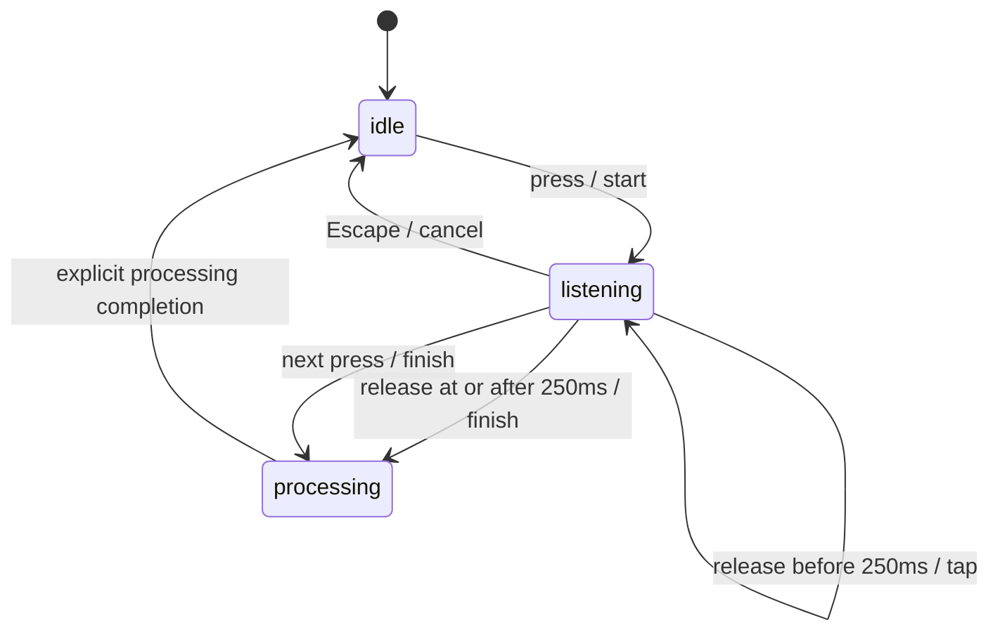

# Milestone 0 feasibility report

Decision: **partial native feasibility established; full spike gate pending**. No product go/no-go conclusion follows from one app alone. [Certain]

Integrated build and `--check` passed on this host. Checks cover tap/hold, repeat/cancel/processing behavior, event-stream loss, UTF16 insertion bounds including emoji surrogate boundaries, read-back mismatch/focus/browser exclusions, observation attribution, undo, expiry, and conflicting two-session evidence. [Certain]

The initial read-only `--inspect --delay 0` probe exited with `No accessible focused field`. The harness now falls back to the actual foreground application's focused AX element, with PID and foreground rechecks. Background TextEdit UI focus did not make TextEdit the macOS foreground app; the user brought the synthetic document forward for the successful tests below. [Certain]

`--listen --listen-seconds 2` created a real CGEventTap with both permission preflights true and exited cleanly after two seconds. This proves listener startup/teardown, not physical shortcut semantics or microphone capture. [Certain]

The user then exercised Right Option physically. An initial unlabeled trace established start/finish and Escape cancellation but lacked a distinct hold cycle. A labeled 45-second retest established both hold-release finishing and tap-stop finishing, with processing returning to idle between sessions: [Certain]

```text
shortcut action=start state=listening
shortcut gesture=hold-release
shortcut action=finish state=processing
shortcut state=idle
shortcut action=start state=listening
shortcut gesture=tap-stop
shortcut action=finish state=processing
shortcut state=idle
```

Right Option tap/hold and Escape cancellation therefore have live keyboard evidence on this device. Fn, configured-chord conflicts, microphone first-word capture, and the M1 baseline remain unverified. Key-repeat and processing suppression remain deterministic-check evidence. [Certain]

## Device and tools

October 2, 2026: MacBook Air Mac15,12, Apple M3, 16 GB RAM, macOS 26.6.2 (25G83), Swift 6.3.3. Accessibility and Input Monitoring preflight returned true for the execution context. The M1/8 GB baseline is unavailable in this run. [Certain]

## Shortcut contract



Repeated down events do not create sessions. A release belonging to the tap that stopped recording cannot finish another session. Processing blocks additional starts. The listener emits actions rather than recording audio; first-word capture and microphone performance remain untested. [Certain]

## Application observation matrix

| Category | Intended test target | Insertion | Observation | Evidence |
|---|---|---|---|---|
| Native editor | TextEdit 1.20 | Verified AX write | Partial pass | Replacement detected, Undo removed evidence, unrelated cursor move stopped observation |
| Browser text field | Arc 1.166.0, local textarea | Unverified; visible text unchanged | Ineligible in tested setup | Native focus exposed AXWebArea; AX write reported success without insertion |
| Rich text | Google Docs/Notion synthetic document | Pending | Pending | No live result yet |
| Chat composer | Synthetic unsent draft | Pending | Pending | No live result yet |
| Code editor | Synthetic disposable editor buffer | Pending | Pending | No live result yet |

Remaining rows are pending, not classified unsupported. Target versions must be recorded when executed. [Certain]

## Native synthetic test evidence

TextEdit 1.20, default rich-text Untitled document, initial text `Native probe: `. The harness inserted `Acme dictation probe` and verified the full AX value. The native UI independently showed `Native probe: Acme dictation probe`. [Certain]

An initial observation attempt exposed the incorrect assumption that AX insertion advances the caret. Tracking now uses the pre-insertion selection offset and verified output. After resetting only the synthetic content, the next live run produced: [Certain]

```text
app=com.apple.TextEdit role=AXTextArea subrole=unknown secure=false valueReadable=true selectionReadable=true learningEligible=true
insertion=verified detail=AX selected-text write matched full-field readback
Observing the synthetic span for at most 60 seconds; text is never printed.
provisionalCandidate=true; no dictionary mapping applied
provisionalCandidate=false; no dictionary mapping applied
observationStopped=selection left dictated span candidateRetained=false
```

The UI actions replaced `Acme` with `Akme`, then Undo restored `Acme`, then moved the caret before `Native`. Native focus departure, app-level 60-second expiry, repeated-session learning, app permission revocation, consecutive dictations, and clipboard fallback remain pending live tests. The structural tracker and evidence ledger cover those branches with deterministic checks, but production semantic eligibility remains unresolved and mappings are not applied. [Certain]

## Browser synthetic test evidence

Arc 1.166.0 (`company.thebrowser.Browser`), local `fields.html` textarea. The user foregrounded the browser and focused Plain text. Native capture exposed `AXWebArea` rather than the textarea. An AX selected-text write returned success, but full-field read-back did not establish delivery; the browser UI independently showed the original `Browser probe: ` value. The harness classified delivery as unverified, did not paste/retry, and did not start learning. [Certain]

```text
app=company.thebrowser.Browser role=AXWebArea subrole=unknown secure=false valueReadable=true selectionReadable=true learningEligible=false
insertion=unverified detail=AX selected-text write delivery unverified; retain output, never automatically retry
```

Reading the foreground app's AXRole did not resolve the field exposure in a subsequent probe; that unsuccessful extra read was removed from the harness. Chromium's main source describes native accessibility activation on this role read and enhanced screen-reader mode through `AXEnhancedUserInterface`, with a two-second debounce. Electron separately documents `AXManualAccessibility`. These describe upstream mechanisms, not verified Arc 1.166.0 behavior. No enhanced accessibility setting was changed in this run. [Certain] ([Chromium source](https://chromium.googlesource.com/chromium/src/+/refs/heads/main/chrome/browser/chrome_browser_application_mac.mm), [Electron documentation](https://github.com/electron/electron/blob/main/docs/tutorial/accessibility.md))

This result is limited to the tested Arc setup. It does not establish Chrome, Safari, password-field detection, or rich-editor compatibility. Unknown browser field types remain excluded from learning. Further browser accessibility setup and field-specific native focus are required before calling this route supported. [Certain]

The final harness also rejects AXWebArea/document roles before insertion and learning. Consequently this Arc setup now reports an unsupported text destination without attempting a write; the earlier silent-success trace remains useful evidence for why read-back verification is required. [Certain]

## Independent review

After implementation handoff, a separate worker reviewed the integrated safety paths and found a clipboard-ownership gap after staging and final AX focus capture. The fallback now attaches a unique token to the staged pasteboard item and checks both token and stable change count immediately before paste and restoration. Deterministic checks cover foreign/missing ownership tokens and change-count races; live clipboard-manager behavior remains pending. NSPasteboard still offers no atomic compare-and-post/restore transaction. [Certain]

Code-editor setup inspection: VS Code 1.138.0, newly created Untitled-1 buffer, reports “The editor is not accessible at this time” and offers screen-reader optimized mode. That mode was not enabled; native insertion/observation remain pending setup. Claude 2.19675.0 has a prepared unsent synthetic Prompt draft; no message was sent. [Certain]

Use synthetic text only. In each category, test verified insertion, an attributable spelling replacement, undo/reversion, appended text, selection outside the span, focus departure, consecutive dictations, and permission revocation. Confirm the 60-second deadline and two distinct-session threshold separately. Mark pass/partial/unsupported with evidence; inability to obtain setup permission is pending setup. [Certain]

## Safety and remaining gates

- AX read-back mismatch must retain the output without another insertion attempt; paste is allowed only when the AX write is unsupported. Clipboard restoration must skip after another writer changes the clipboard. [Certain]
- Known secure fields must be rejected. Browser fields of unknown type must remain unverified and excluded from learning even when text read-back matches. [Certain]
- Anchored range attribution does not prove semantic equivalence. A short replacement can change meaning, so candidates alone cannot justify automatic vocabulary promotion. [Certain]
- Persisted recovery, audio capture, production learning eligibility, model inference, UI, signing, and packaging are outside this standalone spike. [Certain]
- The spike gate remains pending until real keyboard evidence and app-level insertion/observation evidence exist; at least one observation category must pass under the PRD launch floor. [Certain]
