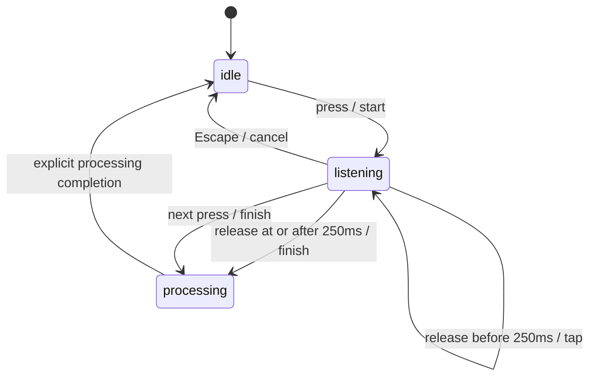

# Milestone 0 feasibility report

Decision: **pending live evidence**. No product go/no-go conclusion follows from deterministic checks alone. [Certain]

Integrated build and `--check` passed on this host. Checks cover tap/hold, repeat/cancel/processing behavior, event-stream loss, UTF16 insertion bounds including emoji surrogate boundaries, read-back mismatch/focus/browser exclusions, observation attribution, undo, expiry, and conflicting two-session evidence. [Certain]

The explicit read-only `--inspect --delay 0` probe exited with `No accessible focused field`. This is a missing live target, not evidence that any category fails AX support. No live insertion or keyboard test was performed. [Certain]

## Device and tools

October 2, 2026: MacBook Air Mac15,12, Apple M3, 16 GB RAM, macOS 26.6.2 (25G83), Swift 6.3.3. Accessibility and Input Monitoring preflight returned true for the execution context. The M1/8 GB baseline is unavailable in this run. [Certain]

## Shortcut contract

Repeated down events do not create sessions. A release belonging to the tap that stopped recording cannot finish another session. Processing blocks additional starts. The listener emits actions rather than recording audio; first-word capture and microphone performance remain untested. [Certain]

## Application observation matrix

| Category | Intended test target | Insertion | Observation | Evidence |
|---|---|---|---|---|
| Native editor | TextEdit | Pending | Pending | No live result yet |
| Browser text field | Safari/Chrome synthetic textarea | Pending | Pending | No live result yet |
| Rich text | Google Docs/Notion synthetic document | Pending | Pending | No live result yet |
| Chat composer | Synthetic unsent draft | Pending | Pending | No live result yet |
| Code editor | Synthetic disposable editor buffer | Pending | Pending | No live result yet |

All rows are untested, not classified unsupported. Target versions must be recorded when executed. [Certain]

Use synthetic text only. In each category, test verified insertion, an attributable spelling replacement, undo/reversion, appended text, selection outside the span, focus departure, consecutive dictations, and permission revocation. Confirm the 60-second deadline and two distinct-session threshold separately. Mark pass/partial/unsupported with evidence; inability to obtain setup permission is pending setup. [Certain]

## Safety and remaining gates

- AX read-back mismatch must retain the output without another insertion attempt; paste is allowed only when the AX write is unsupported. Clipboard restoration must skip after another writer changes the clipboard. [Certain]
- Known secure fields must be rejected. Browser fields of unknown type must remain unverified and excluded from learning even when text read-back matches. [Certain]
- Anchored range attribution does not prove semantic equivalence. A short replacement can change meaning, so candidates alone cannot justify automatic vocabulary promotion. [Certain]
- Persisted recovery, audio capture, production learning eligibility, model inference, UI, signing, and packaging are outside this standalone spike. [Certain]
- The spike gate remains pending until real keyboard evidence and app-level insertion/observation evidence exist; at least one observation category must pass under the PRD launch floor. [Certain]
